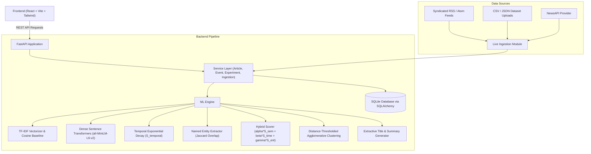

# System Architecture: News Event Detection and Tracking

The **News Event Detection and Tracking System** is designed as a modular, research-oriented full-stack application for automated story discovery, chronological event organization, and quantitative clustering evaluation.

---

## 1. High-Level Architecture Diagram

---

## 2. Component Separation & Responsibilities

### Presentation Layer (Frontend)
- **Framework**: React 19, TypeScript, Vite, Tailwind CSS, Recharts, Lucide icons.
- **Pages**:
  - `OverviewPage`: Global dashboard metrics, category distribution chart, and system parameter overview.
  - `NewsExplorerPage`: Searchable article explorer with source, date, category, and cluster status filters.
  - `EventExplorerPage`: Interactive cluster cards, parameter tuning drawer, and cluster reprocessing triggers.
  - `EventDetailPage`: Event timeline, chronological article sequence, and extractive summaries.
  - `LiveMonitorPage`: Active sync jobs, provider management, and live RSS/API ingestion.
  - `ResearchLabPage`: Execution interface for TF-IDF, Semantic, and Hybrid models with parameter sliders.
  - `EvaluationPage`: 4-way ablation comparative charts and quantitative metric tables.
  - `DatasetManagementPage`: Pre-import validation preview, duplicate detection, and CSV/JSON upload.
  - `SettingsPage`: Model configuration, hybrid weight validation, and API secret management.

### Application Layer (Backend API)
- **Framework**: FastAPI (asynchronous, OpenAPI-documented, Pydantic-validated).
- **Core Endpoints**:
  - `/api/health`, `/api/metadata`, `/api/sources`
  - `/api/articles` (list, search, filter, validate, import)
  - `/api/events` (list, detail, timeline, detect, review)
  - `/api/experiments` (list, run, detail, export)
  - `/api/evaluation/ablation` (4-way comparative study)
  - `/api/ingestion/jobs` (trigger and monitor live feeds)
  - `/api/settings` (persist configuration and weights)

### Machine Learning & NLP Layer
- **Text Normalization**: Regex-based tokenization, HTML stripping, stopword filtering, and SHA-256 content hashing.
- **TF-IDF Baseline**: Sublinear term frequency scaling and unigram/bigram vocabulary.
- **Dense Embeddings**: `sentence-transformers/all-MiniLM-L6-v2` with disk-based `.npy` caching.
- **Temporal Modeling**: Exponential decay function $S_{\text{temporal}} = \exp(-\Delta t / \tau)$.
- **Entity Overlap**: Jaccard similarity across normalized entity sets with neutral prior fallback.
- **Hybrid Fusion**: Convex combination $S = \alpha S_{\text{sem}} + \beta S_{\text{time}} + \gamma S_{\text{ent}}$.
- **Clustering**: Distance-thresholded average-linkage agglomerative clustering.
- **Title Generation**: Deterministic medoid headline selection and extractive lead-sentence summaries.

### Persistence Layer
- **Database**: SQLite (local development with thread-safe session pooling).
- **ORM**: SQLAlchemy 2.0 with strict typed `Mapped` annotations.
- **Tables**: `articles`, `events`, `event_assignments`, `experiments`, `ingestion_jobs`, `system_settings`.
